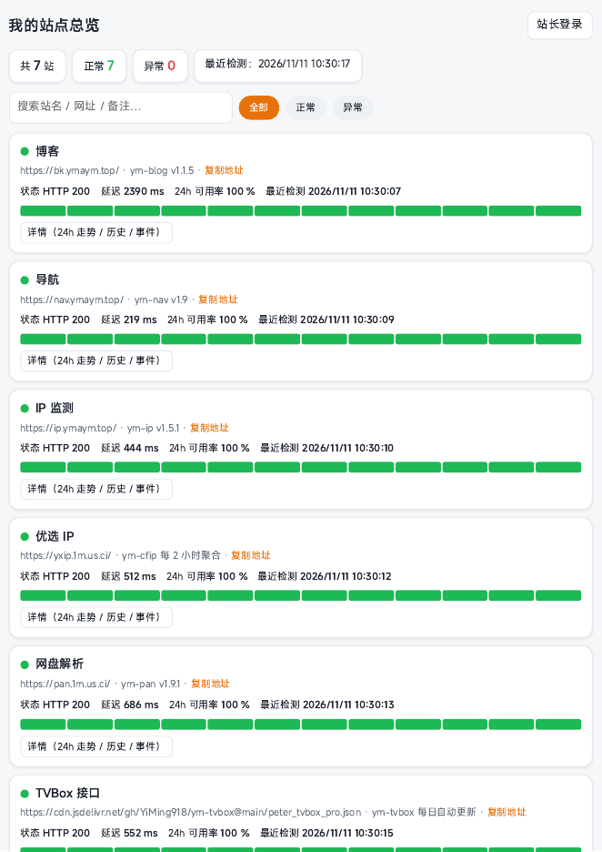

# ym-dash · 站点总览

[](https://github.com/YiMing918/ym-dash/releases/latest)
[](LICENSE)


**自部署的网站状态总览（Status Dashboard）**：把你名下的网站都挂在这一页上——系统每 30 分钟自动探活（Probe，就是「定时去访问一遍你的网站，看它还活着没」）一遍，留历史、算可用率（Uptime）、记掉线与恢复事件。访客打开是只读的公开状态页；站长登录后在页面上点着就能加站、改站、删站，全程不用碰代码。整套跑在 Cloudflare 免费额度里，不需要服务器。

**[打开站点](https://dash.ymaym.top) · [下载最新版](https://github.com/YiMing918/ym-dash/releases/latest) · [博客教程](https://bk.ymaym.top/post/ym-dash-guide)**

> 本文中部署示例域名统一写作 `dash.example.com`，请替换成你自己的。

## 目录

- [功能一览](#功能一览)
- [效果预览](#效果预览)
- [架构](#架构)
- [先选下载文件](#先选下载文件)
- [新手先看这里](#新手先看这里)
- [部署总览与方式对比](#部署总览与方式对比)
- [共同准备：先建 KV 命名空间](#共同准备先建-kv-命名空间)
- [方式一：主站 · 控制台直接上传](#方式一主站--控制台直接上传)
- [方式二：主站 · GitHub 连接自动部署](#方式二主站--github-连接自动部署)
- [方式三：主站 · wrangler 命令行](#方式三主站--wrangler-命令行)
- [方式四：探活 Worker · 控制台粘贴部署](#方式四探活-worker--控制台粘贴部署)
- [方式五：探活 Worker · GitHub Actions 自动部署流水线](#方式五探活-worker--github-actions-自动部署流水线)
- [方式六：探活 Worker · wrangler 命令行](#方式六探活-worker--wrangler-命令行)
- [绑自己的域名](#绑自己的域名)
- [首次初始化站长账号](#首次初始化站长账号)
- [配置表](#配置表)
- [探活：给它加被测站点、确认它在跑](#探活给它加被测站点确认它在跑)
- [保活](#保活)
- [自动更新 / 自动任务](#自动更新--自动任务)
- [日常使用](#日常使用)
- [已知边界](#已知边界)
- [与同类有什么不同 / 优点 / 缺点](#与同类有什么不同--优点--缺点)
- [FAQ](#faq)
- [目录结构](#目录结构)
- [更新日志](#更新日志)
- [维护](#维护)
- [许可证](#许可证)

## 功能一览

| 功能 | 说明 |
|---|---|
| 公开状态页 | 未登录即可看：每站状态灯、HTTP 状态码、延迟、24h 可用率，无敏感信息 |
| 自动探活 | 独立 Cron Worker 每 30 分钟全量探活一遍，结果写入 KV，不打开页面也在测 |
| 历史与趋势 | 每站保留最近 96 条检测；列表带最近 12 次小趋势条，详情有 24h 延迟走势图与逐条历史 |
| 可用率 | 24 小时可用率按历史记录现算，不是摆设数字 |
| 事件记录 | 掉线 / 恢复自动记账（最近 100 条），含时间和原因摘要 |
| 掉线告警条 | 有站异常时页面顶部置红条：站名 + 已掉线时长 |
| 站长管理 | 登录后页面上添加 / 编辑 / 删除站点、单站重测、全部重测、改站点标题 |
| 搜索与筛选 | 按站名 / 网址 / 备注搜，按全部 / 正常 / 异常筛 |
| 安全 | 站长初始化后关闭敞口（可选环境变量 `SETUP_TOKEN` 给初始化再加一道口令）；密码 PBKDF2 加盐哈希；登录按来源 IP 限流（连错 5 次锁该 IP 15 分钟）；探活带 SSRF 防护（拒绝内网 / 回环地址，重定向逐跳复检） |
| 示例模式 | 还没加站时显示 2 个明确标注的示例站，不假装在监控真站 |

## 效果预览



公开状态页（访客视角）：每站一张卡——状态灯、地址、HTTP 状态、延迟、24h 可用率与最近 12 次检测趋势条；站长登录后可添加 / 编辑 / 删除站点与手动重测。

## 架构

```
访客/站长 ──► Cloudflare Pages（index.html 单文件前端 + Functions API）
                        │  绑定 KV（DASH_KV）
                        ▼
                   Workers KV ── sites / histall / events / admin …
                        ▲
                        │  同一个 KV
              Cron Worker（ym-dash-check，*/30 * * * *）
                        └── 每 30 分钟 fetch 探活全部站点并落库
```

- 前端：单个 `index.html`，原生 JS，无构建、无框架依赖；深浅色跟随系统。
- 接口：`functions/api/[[path]].js` 转发到 `functions/_lib/router.js`；数据层 `store.js`、探活 `probe.js`、账号 `auth.js`。
- 定时探活是**独立 Worker**（`worker/` 目录），与主站共用同一个 KV。探活逻辑在站点侧与 Worker 侧各有一份（Worker 独立部署不能跨目录引用），文件头写有同步点说明，改一处必须同步另一处——细节见 [MAINTENANCE.md](MAINTENANCE.md)。

## 先选下载文件

| 部署方式 | 下载文件 | 怎么用 |
| --- | --- | --- |
| 主站控制台直接上传（方式一） | 发行版里的 `ym-dash-deploy-*.zip` | 解压后把主站文件上传到 Pages 项目；包里还带 `worker/` 子目录，那是探活 Worker 的部分，不要传进主站 |
| 探活 Worker 控制台粘贴（方式四） | 同一个 zip 里的 `worker/worker.js` | 解压后打开这个文件，全文复制，粘贴到 Cloudflare 的 Worker 在线编辑器里 |
| GitHub 连接 / Actions 流水线（方式二、五） | 不用下载 zip | 直接 Fork 本仓库到你的 GitHub 账号在线部署 |
| wrangler 命令行（方式三、六） | Fork / 克隆本仓库到电脑 | 在本地目录里用命令部署，zip 也能解压当源码用 |

注意：发行版里附的 `SHA256SUMS.txt` 是校验文件，用来核对 zip 下载得完不完整（用系统自带的 SHA-256 工具算一遍和它对一下即可）。GitHub 页面上自动生成的 **Source code (zip / tar.gz)** 是整个仓库的源码快照，**不能直接当部署包上传**，部署请下发行版里标好名字的 zip。

## 新手先看这里

部署这个项目，你要先认识四样东西，后面每一步都围绕它们转：

1. **Cloudflare 账号**（免费注册）：这个项目的一切都跑在它上面。控制台网址是 `dash.cloudflare.com`，后文说的「后台」都指这里。
2. **Pages**（Cloudflare 的一种托管服务）：放网页和接口的地方。本项目的**主站**就部署成一个 Pages 项目。
3. **Worker**（Cloudflare 的一段云端小程序）：本项目的**探活程序**是一个独立 Worker，它不给人看页面，只负责每 30 分钟把你的站点挨个访问一遍。
4. **KV**（Cloudflare 的云端键值仓库，可以理解成一张全站共用的大表格）：主站和探活 Worker 共用同一个 KV 存数据——站点清单、检测历史、事件、站长账号都在里面。代码里管它叫绑定名 `DASH_KV`（绑定名就是「在设置里给这仓库起的代号」，必须一字不差）。

所以整个部署就是三件事：**建一个 KV → 把主站部署上 Pages 并绑这个 KV → 把探活 Worker 部署上并绑同一个 KV**。主站和 Worker 的部署方法各有三种，下面先对比、再逐个细讲，任选一套组合即可（最常见：主站方式一或二 + Worker 方式四或五）。

还要准备的：**GitHub 账号**（免费注册，走 GitHub 路线时要用）；**自己的域名**（可选，没有就先用 Cloudflare 给的 `*.pages.dev` / `*.workers.dev` 免费地址，之后随时能绑自己的域名）。全程不需要服务器、不需要付费。

### 先分清两个地方：GitHub 和 Cloudflare

部署全程只打交道两个网站，先分清谁是谁，后面每一步你都知道自己在哪个网站、干什么：

| 地方 | 它是干什么的 | 本项目在它这里用到什么 |
| --- | --- | --- |
| **GitHub**（github.com） | 放**代码**的地方 | **仓库（Repository）**：就是一个存代码的文件夹，本项目的全部文件都在里面；**Actions**：仓库自带的自动干活机器人，本项目用它自动部署探活 Worker（方式五）和每次推送时自动跑一遍冒烟检查；**Releases（发行版）**：仓库里专门放成品包给人下载的货架，本项目的手机部署包 zip 就在这里下；**Secrets**：仓库设置里的保险柜，专门存不能公开的钥匙（比如部署用的 API 令牌），存进去之后谁都看不到原文 |
| **Cloudflare**（dash.cloudflare.com） | 让项目**跑起来**的地方 | **Pages**（左侧「Workers 和 Pages」里建）：托管主站的网页和接口；**Workers**（同一个菜单里建）：跑探活小程序；**KV**（左侧「存储和数据库 → KV」）：主站和探活 Worker 共用的数据仓库；**Cron 触发器**（在 Worker 的「设置 → 触发器」里加）：一个定时闹钟，每 30 分钟叫醒探活 Worker 干活 |

**两边怎么配合，一句话**：代码平时躺在 GitHub 仓库里；主站和探活 Worker 实际跑在 Cloudflare 上、共用同一个 KV 存数据。你在 GitHub 这边改完代码点推送（push），按方式二/五配好的自动通道就会把新代码送到 Cloudflare 上线——所以日常改东西只去 GitHub，真要查运行状态、改绑定，才去 Cloudflare。

## 部署总览与方式对比

### 主站（Pages）的三种部署方式

| 对比维度 | 方式一：控制台直接上传 | 方式二：GitHub 连接自动部署 | 方式三：wrangler 命令行 |
| --- | --- | --- | --- |
| 需要什么设备 | 手机或电脑浏览器都行 | 浏览器 + GitHub 账号 | 电脑（要装 Node.js 和命令行工具） |
| 上手难度 | 最低，全程点鼠标 | 中等，要先会把仓库 Fork 到自己账号 | 最高，要会用终端敲命令 |
| 第一次大约耗时 | 10 分钟左右 | 15 分钟左右（含授权连接） | 15–25 分钟（含装环境） |
| 日常更新方不方便 | 不方便：每次改代码都要重新打包上传 | 最方便：推送代码自动重新部署 | 一般：一条命令部署，但要自己在电脑上执行 |
| 出错了好不好排查 | 一般：多半是漏文件，照自查清单逐项数 | 好：部署记录在 Pages 项目里能回看、能回滚 | 好：终端里直接报哪一步错 |
| 适合谁 | 手机党、第一次部署、先跑起来再说 | 打算长期用、经常改的人（**最推荐**） | 本来就会命令行的人 |

### 探活 Worker 的三种部署方式

| 对比维度 | 方式四：控制台粘贴部署 | 方式五：GitHub Actions 流水线 | 方式六：wrangler 命令行 |
| --- | --- | --- | --- |
| 需要什么设备 | 手机或电脑浏览器都行 | 浏览器 + GitHub 账号 | 电脑（要装 Node.js 和命令行工具） |
| 上手难度 | 低，复制粘贴 + 点几下设置 | 中等，要先按五点规则配好 3 个仓库 Secret | 最高，要会用终端敲命令 |
| 第一次大约耗时 | 10 分钟左右 | 20 分钟左右（含建令牌、配 Secret） | 15 分钟左右 |
| 日常更新方不方便 | 不方便：改一次粘一次，还要记得 Cron 和绑定别动 | 最方便：推送 `worker/` 的改动自动部署，还带上线自检 | 一般：进 `worker/` 目录一条命令 |
| 出错了好不好排查 | 一般：要自己去 Worker 设置里逐项核对绑定和触发器 | 好：流水线红了会停在具体步骤，自检不过会明确示警 | 好：终端里直接报哪一步错 |
| 适合谁 | 第一次部署、不想碰 GitHub 配置的人 | 长期用、怕手动粘贴漏步骤的人（**最推荐**） | 本来就会命令行的人 |

**看完对比怎么选**：只想先跑起来 → 主站方式一 + Worker 方式四；打算长期挂着用 → 主站方式二 + Worker 方式五；会命令行 → 怎么顺手怎么来。下面每种方式都写全步骤，照着做即可，六种方式的最终效果完全一样。

## 共同准备：先建 KV 命名空间

六种方式都要先做这一步（只做一次）：

1. 打开 `dash.cloudflare.com` 登录 → 左侧点「存储和数据库（Storage & Databases）」→「KV」→ 点「创建命名空间（Create namespace）」；
2. 名字随便填（例如 `ym-dash-kv`）→ 点创建；
3. 创建完列表里会显示这个命名空间的 **ID**（一串字母数字）。这个 ID 后面要反复用：绑 Pages 时要用、绑 Worker 时要用、走命令行或流水线时还要填进配置。
   - **这个 ID 要不要保存？** 建议顺手记在自己的备忘录里。它不算秘密（光有 ID 没你的账号权限也读不到数据），但丢了也不怕——随时回这个 KV 列表页就能再看到。

做到这里你应该看到：KV 列表里有你刚建的命名空间，ID 可见。

## 方式一：主站 · 控制台直接上传

**优势**

- 不用 GitHub 账号、不用电脑，手机浏览器就能全程办完；
- 步骤最少，最快看到站点跑起来的样子；
- 不涉及任何令牌、密钥，配错的风险最低。

**劣势**

- 以后代码有更新，要重新下载 zip、重新上传一遍，没有自动更新；
- 最容易踩的坑是打包时漏文件、漏目录（下面有专门的自查法）；
- 部署记录和回滚能力弱，传错了只能再传一次覆盖。

**要用到的东西**

- 发行版 zip（见「先选下载文件」）解压出的文件；
- 「共同准备」里建好的 KV 命名空间。

**步骤**

<details>
<summary>点开看详细步骤</summary>

1. 在本仓库的 Releases 页下载最新版 `ym-dash-deploy-*.zip` 并解压。解压后你应该能看到：根目录有 `index.html`，还有一个 `functions/` 文件夹（里面有 `api/` 和 `_lib/`）；另有一个 `worker/` 文件夹——那是探活 Worker 的，别传进主站，第 4 步单独用。
2. 打开 Cloudflare 后台 →「Workers 和 Pages」→「创建（Create）」→ 选「Pages」→「上传资产（Upload assets）」；
3. 项目名随便填（例如 `ym-dash`），把 `index.html` 和 `functions/` 一起拖进去（或点上传逐个选）→ 点「部署」。
   - ⚠️ **直传最常见的翻车：漏 `functions/` 目录**。后果按漏的东西分：漏 `index.html` → 打开是 404 或空白页；漏 `functions/` → 页面看着能开，但状态页一直「加载失败」、登录和加站都用不了。上传前逐项数一遍：必须有 `index.html` 和 `functions/`（展开里面应有 `api/[[path]].js` 与 `_lib/` 下的 4 个 js 文件）。
4. 部署完先别走，给这个 Pages 项目绑 KV：点进刚建的项目 →「设置（Settings）」→「绑定（Bindings）」→「添加」→「KV 命名空间」：
   - 变量名（绑定名）必须一字不差填 **`DASH_KV`**；
   - 命名空间选「共同准备」里建的那个 → 保存。
5. 回到项目的「部署（Deployments）」页，点最新一条部署右侧的菜单 →「重试部署（Retry deployment）」，让绑定生效。

做到这里你应该看到：打开项目给的 `*.pages.dev` 地址，能看到状态页界面（此时是示例站，因为还没初始化、没加真站）。

</details>

**部署完怎么验**

- 浏览器打开 `你的地址/api/public`，应该返回一串 JSON 数据（大括号开头的那种文本），不是网页——说明 `functions/` 传齐了、KV 也绑上了；
- 打开站点首页能看到 2 个标着「示例」的站点卡片——说明页面部分正常。

**常见问题**

- 页面能开但一直「加载失败」：十有八九是 `functions/` 没传或 KV 没绑好，按上面第 3、4 步逐项核对，改完绑定记得重新部署一次。
- 绑 KV 时找不到命名空间：回「存储和数据库 → KV」确认已经建好，且和 Pages 项目在**同一个 Cloudflare 账号**下。

## 方式二：主站 · GitHub 连接自动部署

**优势**

- 一次配好，以后推送代码到仓库，Pages 自动重新部署，日常更新最省心；
- 每次部署都有记录，出问题能在后台一键回滚到上一版；
- 不用每次手动打包，不会漏文件。

**劣势**

- 第一次要授权 Cloudflare 访问你的 GitHub 账号，多几步；
- 仓库必须是你的（先 Fork），跟着别人的仓库连不上自动部署；
- 探活 Worker 不走这条路，还得单独按方式四/五/六部署。

**要用到的东西**

- GitHub 账号，并把本仓库 **Fork**（在仓库页面右上角点 Fork，就是把仓库复制一份到你自己账号下）；
- 「共同准备」里建好的 KV 命名空间。

**步骤**

<details>
<summary>点开看详细步骤</summary>

1. 先把本仓库 Fork 到你的 GitHub 账号（仓库页右上角「Fork」→ 选你的账号 → 等复制完成）。
2. 打开 Cloudflare 后台 →「Workers 和 Pages」→「创建」→「Pages」→「连接到 Git（Connect to Git）」→ 按提示授权并选择你 Fork 的那个仓库；
3. 构建设置这样填：框架预设选「无（None）」、构建命令**留空**、构建输出目录填 `/`、生产分支选 `main` → 点「保存并部署」；
4. 等它部署完，再给项目绑 KV：进项目 →「设置」→「绑定」→「添加」→「KV 命名空间」，变量名填 **`DASH_KV`**、命名空间选共同准备建的那个 → 保存；
5. 到「部署」页对最新部署点「重试部署」让绑定生效（或者随便往仓库推一个小改动，也会触发一次新部署）。

做到这里你应该看到：Pages 项目的部署列表里有一条成功记录，打开 `*.pages.dev` 地址能看到状态页。

</details>

**部署完怎么验**

- 往你的仓库推一个无关痛痒的小改动（比如改 README 一个字），回 Pages 后台看部署列表——一两分钟内应该自动多出一条新部署，说明自动部署通了；
- 同方式一，打开 `你的地址/api/public` 应返回 JSON。

**常见问题**

- 推送了没反应：检查 Pages 项目连的是不是你 Fork 的仓库、生产分支是不是 `main`，在项目的「设置 → 构建和部署」里能看到连接关系。
- 部署成功但页面报 KV 相关错误：绑定名必须是 `DASH_KV`，且绑完要重新部署才生效（见第 5 步）。

## 方式三：主站 · wrangler 命令行

**优势**

- 一条命令部署，不用在网页上点来点去；
- 出错信息直接打在终端里，排查最快；
- 配置写在文件里，换电脑、换环境照着文件就能复现。

**劣势**

- 要在电脑上装 Node.js 和 wrangler（Cloudflare 的官方命令行工具），纯手机党用不了；
- `wrangler.toml` 里的 KV id 填错一位就绑错库，还不容易看出来；
- 第一次还要走一遍 wrangler 登录授权。

**要用到的东西**

- 电脑 + Node.js（18 以上）+ 本仓库源码（Fork 后克隆到本地，或解压发行版 zip）；
- 「共同准备」里建好的 KV 命名空间 **ID**。

**步骤**

<details>
<summary>点开看详细步骤</summary>

1. 在仓库根目录，把 `wrangler.toml.example` 复制一份改名为 `wrangler.toml`，用文本编辑器打开，把里面 `id = "在这里填你的KV命名空间ID"` 换成你自己的 KV 命名空间 ID。绑定名 `DASH_KV` 已经写好，别改。
2. 终端进入仓库根目录，第一次先登录：`npx wrangler login`（会弹浏览器让你授权，点允许）。
3. 执行部署：`npx wrangler pages deploy .`，按提示选/建项目（名字自定）。
4. 部署完终端会打印出访问地址。

做到这里你应该看到：终端显示部署成功并给出 `*.pages.dev` 地址，打开能看到状态页。

</details>

**部署完怎么验**

- 同方式一：`你的地址/api/public` 返回 JSON 即正常。
- 如果报 KV 相关错误，先回头核对 `wrangler.toml` 里的 id 是不是你那个命名空间的，一字都不能差。

**常见问题**

- `wrangler` 命令不存在：先装 Node.js，再用 `npx wrangler ...` 的写法（npx 会临时拉取，不用全局安装）。
- 部署成功但数据像「新的」：多半是 id 填成了另一个命名空间——主站和 Worker 必须用**同一个** id。

## 方式四：探活 Worker · 控制台粘贴部署

**优势**

- 不用 GitHub、不用电脑，浏览器里复制粘贴就能完成；
- 每一步都看得见摸得着，适合第一次部署时建立概念；
- 不涉及任何令牌、Secret，配错了也好回退。

**劣势**

- 以后 `worker.js` 有更新，要重新打开编辑器整段粘贴一遍；
- 绑定和 Cron 触发器是手动加的，漏加一样探活就不跑，还不容易发现；
- 没有自动自检，部署完得自己按「探活」一节的方法确认它在跑。

**要用到的东西**

- 发行版 zip 里 `worker/worker.js` 的全文（或仓库 `worker/` 目录里的同名文件）；
- 「共同准备」里建好的 KV 命名空间（和主站必须是同一个）。

**步骤**

<details>
<summary>点开看详细步骤</summary>

1. 打开 Cloudflare 后台 →「Workers 和 Pages」→「创建」→ 选「Worker」→ 名字填 `ym-dash-check`（自定也可，但后面流水线/文档都按这个名字说）→ 点「部署」先生成一个默认 Worker。
2. 点进这个 Worker → 点「编辑代码（Edit code）」→ 把编辑器里原有的示例代码全选删掉 → 打开 `worker.js`，全文复制粘贴进来 → 点「部署（Deploy）」保存。
3. 给它绑同一个 KV：回到 Worker 的「设置（Settings）」→「绑定（Bindings）」→「添加」→「KV 命名空间」：
   - 变量名填 **`DASH_KV`**（和主站一字不差）；
   - 命名空间选共同准备建的那个（必须是主站绑的同一个，填错就等于各写各的库，页面永远等不到数据）。
4. 给它加定时触发：还在 Worker 的「设置」→「触发器（Triggers）」→「Cron 触发器」一栏 →「添加」→ 表达式填 `*/30 * * * *`（意思是每 30 分钟跑一次）→ 保存。

做到这里你应该看到：Worker 的「触发器」页里有一条 `*/30 * * * *` 的 Cron 记录；直接用浏览器打开这个 Worker 的 `*.workers.dev` 地址，会显示一句它在岗的说明文字。

</details>

**部署完怎么验**

- 按后面「探活」一节给总览加一个被测站点，点「全部重测」能出结果；等过 35 分钟再看，总览页上该站的「最近检测时间」应该已经自己往前走了——说明 Cron 在自动跑。
- 如果时间一直不动，按「探活」一节的排查顺序查绑定和触发器。

**常见问题**

- Worker 打开是报错而不是在岗说明：多半是粘贴时代码不完整（漏了尾巴），重新全选覆盖粘贴一次。
- 页面上的站一直不更新：先查 Cron 触发器有没有加对，再查 KV 是不是同一个（id 对不对得上）。

## 方式五：探活 Worker · GitHub Actions 自动部署流水线

**优势**

- 一次配好，以后改 `worker/` 里任何文件并推送，自动部署上线，日后更新最省心；
- 部署失败会自动重试 3 次（Cloudflare 上传接口偶尔抖动），部署完还有一道只读自检：核对 KV 绑定在不在、每 30 分钟的定时在不在、站点接口活不活，不过会明确变红示警，不会静默失败；
- 配置里的真实 ID 只存在仓库 Secrets 里，不写进代码、不会随仓库公开。

**劣势**

- 第一次配置最繁琐：要建一个 Cloudflare API 令牌、再往 GitHub 仓库填 3 个 Secret，漏一个流水线就跑不起来；
- 出问题要会看 GitHub Actions 的运行日志（下面写了看哪一步）；
- 令牌权限给大了有安全风险，必须按下面说的最小权限来建。

**要用到的东西**

- 你 Fork 的仓库（流水线文件 `.github/workflows/deploy-worker.yml` 已在仓库里，不用你写）；
- 「共同准备」里建好的 KV 命名空间 ID；
- 下面这 3 样凭据，先逐个看懂再动手——

**凭据 1：`CLOUDFLARE_API_TOKEN`（Cloudflare API 令牌）**

1. **是什么**：一把给程序用的「钥匙」。流水线拿着它，才能以你的身份把 Worker 部署到你的 Cloudflare 账号上。它不是你的账号密码，有效范围只限你建它时勾的权限。
2. **去哪建**：Cloudflare 后台右上角点你的头像 →「我的个人资料（My Profile）」→「API 令牌（API Tokens）」→「创建令牌（Create Token）」→ 选「创建自定义令牌（Custom token）」。权限按最小够用勾：账户（Account）→「Workers 脚本（Workers Scripts）」编辑、「Workers KV 存储（Workers KV Storage）」编辑；账户资源选你自己的账号。建好点「创建」。
3. **填到哪用**：填进 GitHub 仓库的 Secret（名字必须叫 `CLOUDFLARE_API_TOKEN`，填法见下面步骤），流水线每次运行时自动取用，你不用再碰。
4. **干什么用的**：只干一件事——让流水线部署 `ym-dash-check` 这个 Worker 并做部署后自检。
5. **要不要保存、丢了怎么办**：⚠️ **令牌只在创建成功那一页完整显示一次**，关掉就再也看不到。建好的当下立刻复制、先粘贴进仓库 Secret（下一步就要用）。如果你想留备份，只能存进你自己的密码管理器，**不要**写进代码、README 或任何会公开的文件。真丢了也不用慌：回「API 令牌」页把旧令牌删掉（或点滚动/轮换），重新建一把、把仓库 Secret 里的值换成新的即可，站点数据不受任何影响。以后只有「换了部署方式、令牌被删、怀疑泄露」时才需要再动它。

**凭据 2：`CLOUDFLARE_ACCOUNT_ID`（Cloudflare 账户 ID）**

1. **是什么**：你 Cloudflare 账号的编号，告诉流水线「部署到哪个账号」。
2. **去哪拿**：Cloudflare 后台 →「Workers 和 Pages」总览页的右侧边栏就能看到「账户 ID（Account ID）」；或任意一个域名的「概述」页右下角也有。它不是秘密，丢不了、随看随有。
3. **填到哪用**：GitHub 仓库 Secret，名字 `CLOUDFLARE_ACCOUNT_ID`。
4. **要不要保存**：不用特意保存，哪天要看回后台就有。

**凭据 3：`DASH_KV_ID`（探活要用的那个 KV 命名空间 ID）**

1. **是什么**：「共同准备」里你建的那个 KV 命名空间的 ID。流水线用它生成 Worker 的配置文件，保证 Worker 和主站绑的是同一个 KV。
2. **去哪拿**：Cloudflare 后台 →「存储和数据库」→「KV」，列表里你那个命名空间后面就是它的 ID。
3. **填到哪用**：GitHub 仓库 Secret，名字 `DASH_KV_ID`。
4. **要不要保存**：同账户 ID，不用特意保存，回 KV 列表页随时能看。注意别填成主站之外的另一个命名空间——填错探活数据会写进另一个库，页面上看不到。

**步骤**

<details>
<summary>点开看详细步骤</summary>

1. 先确认仓库是你 Fork 到自己账号下的那份（流水线只能跑在你自己的仓库里）。
2. 把 3 个 Secret 逐个填进仓库：打开你的仓库页 → 顶部「Settings（设置）」→ 左侧「Secrets and variables（机密和变量）」→「Actions」→ 点「New repository secret（新建仓库机密）」：
   - 第一个：Name 填 `CLOUDFLARE_API_TOKEN`，Secret 粘贴你刚建的令牌 →「Add secret」；
   - 第二个：Name 填 `CLOUDFLARE_ACCOUNT_ID`，Secret 填账户 ID →「Add secret」；
   - 第三个：Name 填 `DASH_KV_ID`，Secret 填 KV 命名空间 ID →「Add secret」。
   填完列表里应该有这 3 条（只显示名字，值看不见，这是正常的——Secret 存进去之后任何人都看不到原文，包括你自己）。
3. 触发第一次部署：仓库页顶部「Actions」→ 左侧选「deploy-worker」→ 右侧「Run workflow（运行工作流）」→ 点确认。等它跑完变绿勾。
4. 以后只要推送 `worker/` 目录下的改动，它会自动跑；也可以随时按第 3 步手动触发。

做到这里你应该看到：Actions 里 deploy-worker 最近一次运行是绿色对勾；Cloudflare 后台的 Workers 列表里出现 `ym-dash-check`，它的触发器里有 `*/30 * * * *`。

</details>

**部署完怎么验**

- 同方式四：给总览加一个站，等一轮（≤35 分钟）看检测时间是否自己更新。
- 流水线最后一步「上线自检」变绿，就说明 KV 绑定、Cron、站点接口三样都对上了，比手动逐项查更省事。

**常见问题**

- 流水线第一步就红：多半是 Secret 名字拼错或没填——回仓库 Settings 的 Actions Secrets 列表逐字核对 3 个名字。
- 部署步骤报权限错误：令牌权限不够，回 Cloudflare 把令牌的权限按上面凭据 1 的清单补齐，或干脆删掉重建一把。
- 流水线绿了但探活不更新：看自检那一步的日志，它会指出是绑定不在还是定时不在；都绿还不行，再查 `DASH_KV_ID` 是不是填成了别的命名空间。

## 方式六：探活 Worker · wrangler 命令行

**优势**

- 一条命令完成部署，连 Cron 触发器都写在配置文件里，不用去后台手动加；
- 出错直接报在终端，排查快；
- 和方式五效果等价，不用配 GitHub Secret。

**劣势**

- 要电脑和命令行环境，第一次还要登录授权；
- `worker/wrangler.toml` 里的 KV id 必须和主站填同一个，手滑填错不易察觉；
- 以后每次更新都要自己在电脑上再跑一次命令。

**要用到的东西**

- 电脑 + Node.js（18 以上）+ 本仓库源码；
- 「共同准备」里建好的 KV 命名空间 ID。

**步骤**

<details>
<summary>点开看详细步骤</summary>

1. 进入仓库的 `worker/` 目录，把 `wrangler.toml.example` 复制一份改名为 `wrangler.toml`，把里面的 id 换成你的 KV 命名空间 ID（**必须与主站用的同一个**）。每 30 分钟的 Cron 已经写在这份配置里，不用再去后台加。
2. 终端在 `worker/` 目录里执行：`npx wrangler deploy`（第一次会让你登录授权，点允许）。
3. 终端显示部署成功并给出 Worker 地址，即完成。

做到这里你应该看到：Cloudflare 后台 Workers 列表里有 `ym-dash-check`，触发器里自动带了 `*/30 * * * *`。

</details>

**部署完怎么验**

- 同方式四：加站后等一轮，看检测时间是否自己更新；直接打开 Worker 地址应显示在岗说明。

**常见问题**

- 部署成功但页面没数据：核对 `worker/wrangler.toml` 与主站配置里的 KV id 是否完全一致。
- 改了探活频率：改这份配置里的 `crons` 后重新 deploy，并同步考虑 KV 写额度（见「已知边界」）。

## 绑自己的域名

主站跑起来后（任一方式），想用自己的子域名（例如 `dash.example.com`）：

1. Cloudflare 后台 → 进你的 Pages 项目 →「自定义域（Custom domains）」→「添加」→ 填你的子域名；
2. 如果域名本身就在 Cloudflare 托管，DNS 记录会自动加好；不在的话按页面提示去你的域名商那里加一条 CNAME 记录指向项目地址；
3. 等状态变成「有效（Active）」就能用新域名打开了（证书由 Cloudflare 自动签，不用你管）。

做到这里你应该看到：用你的域名打开能看到和 `*.pages.dev` 地址一模一样的状态页。

## 首次初始化站长账号

主站和 Worker 都部署完、KV 都绑好后，做这一件事把站「收口」：

1. 打开你的站点，点右上角「站长初始化」；
2. 设置**用户名**和**密码**（至少 6 位）→ 提交。
   - 这组用户名密码就是你以后登录后台加站、改站用的，系统只存它的加盐哈希（存进 KV），原文不落库。**请务必自己记牢**（记在密码管理器或备忘录里）：本站没有找回密码的邮件通道，真忘了，只能按 [MAINTENANCE.md](MAINTENANCE.md) 的恢复步骤删掉 KV 里的 `admin` 键重新初始化（站点清单和历史数据不受影响，但旧登录会话会全部失效，需要重新登录）。
3. **初始化完成后入口自动关闭**，右上角变成「站长登录」——在这之前，任何打开页面的人都能抢注这个站长位，所以部署完请第一时间初始化。
4. 想更稳妥（可选）：部署前在 Pages 项目「设置 → 环境变量」里加一个 `SETUP_TOKEN`（值自己随便定一串长一点的口令，定好记下来），初始化时表单会多要求填对它，别人才抢不了这个窗口。`SETUP_TOKEN` 只在初始化那一次用，初始化完就不再需要，但留着不删也没影响；万一初始化前忘了它，直接回环境变量里改一个新值、重新部署一次即可。

做到这里你应该看到：右上角显示「站长登录」，点它能用刚设的用户名密码登录，登录后能看到「添加站点」入口。

## 配置表

| 配置 | 在哪 | 说明 |
|---|---|---|
| KV 绑定名 | Pages 与 Worker 的绑定设置 | 必须都叫 `DASH_KV`，且指向同一个命名空间 |
| 探活间隔 | Worker 的 Cron 表达式 | 默认 `*/30 * * * *`（30 分钟）；改密要同步考虑 KV 写额度（见已知边界） |
| 探活超时 | `functions/_lib/probe.js` 的 `probeUrl` 默认参数 | 默认 10 秒；改后必须同步 `worker/worker.js` 同名函数 |
| 历史保留 | `HIST_CAP`（两处：`store.js` / `worker.js`） | 默认每站 96 条（30 分钟一条 ≈ 48 小时） |
| 事件保留 | `EVENTS_CAP`（同上两处） | 默认 100 条 |
| 站点标题 | 登录后页面上「改标题」 | 存 KV 的 `settings`，不用改代码 |
| 会话时长 | `functions/_lib/auth.js` 的 `SESSION_TTL_MS` | 默认 7 天 |

## 探活：给它加被测站点、确认它在跑

这个项目本身就是探活系统，所以这一节讲两件事：怎么把你自己的站加进来让它测，以及怎么确认探活 Worker 真的在按时跑。

### 加一个被测站点（手把手）

1. 打开你的总览站点（你的域名或 `*.pages.dev` 地址），点右上角「站长登录」，填初始化时设的用户名、密码登录；
2. 登录后点「添加站点」，表单里逐项填：
- **站名**：你自己认得的名字即可（例如「我的博客」）；
- **网址**：被测站点的完整地址，必须以 `http://` 或 `https://` 开头（例如 `https://bk.example.com`）。注意：只允许公网地址，内网地址（如 `192.168.x.x`、`localhost`）会被拒绝——这是防滥用的安全设计，不是故障；
- **备注**：可填可不填，自己备忘用。
3. 点「保存」。新站会立刻出现在列表里，状态先是未知；
4. 想马上出结果，不用等自动轮次：点这个站的「重测」，或页面上的「全部重测」。一两秒后应该看到状态灯变绿（或变红）、旁边有 HTTP 状态码（正常一般是 200）和延迟毫秒数。

做到这里你应该看到：新站卡片上显示 200、一个毫秒数字、可用率开始有数字——这个站已经纳入监控了。

### 确认探活 Worker 在自动跑

加站只是把名单放进 KV，真正在背后每 30 分钟挨个访问的是探活 Worker。确认它在岗，看这三处任意一处：

1. **看总览页的时间戳（最直接）**：任选一个站，看它的「最近检测时间」。等超过 35 分钟再刷新页面，这个时间应该自己往前走了（不需要你点任何东西）。时间会自己动 = Cron 在触发、Worker 在干活。
2. **看 Cloudflare 后台**：后台 →「Workers 和 Pages」→ 点 `ym-dash-check` →「设置 → 触发器」，应有一条 `*/30 * * * *` 的 Cron 记录；「指标（Metrics）」里能看到它每半小时被调用一次的痕迹。
3. **直接访问 Worker 地址**：浏览器打开它的 `*.workers.dev` 地址，应显示一句它在岗的说明文字。能显示说明它部署成功了；但注意这只证明代码在，绑定和 Cron 对不对还得靠前两条确认。

**探什么才算「活着」**：探活会真的去请求被测站的网址，返回的 HTTP 状态码是 2xx（成功类）或 3xx（跳转类）算正常，其余（连不上、超时、4xx/5xx）算异常。它只判断「能不能连上 + 状态码」，不判断网页内容对不对（见「已知边界」）。

**加了站一直不更新，按这个顺序查**：① Cron 触发器有没有加对（`*/30 * * * *`）；② Worker 绑的 KV 和主站是不是同一个（设置里对比命名空间，或核对两处填的 ID）；③ Worker 代码是不是最新版（对照仓库 `worker/worker.js`）。

## 保活

**结论：不需要给它「保活」，但有三样东西别动、别忘。**

- **不用定期去点它**：探活靠的是 Cloudflare 自己的 Cron 触发器，闹钟在 Cloudflare 那边响，不依赖 GitHub 仓库活不活跃，也不需要你定期打开页面「叫醒」它——哪怕你一个月不登录，它也照样每 30 分钟测一轮。Pages 和 Worker 本身也没有「闲置休眠」这回事。
- **KV 命名空间千万别删**：站点清单、全部历史、事件、你的站长账号都在里面，删了等于整套数据清零，且删了找不回来。要清理数据只在页面上删站点，不要去后台删命名空间。
- **域名记得续费**：绑了自己域名的，域名到期站点就打不开了（这和项目本身无关，是域名的事）；用 `*.pages.dev` 免费地址的没有这个烦恼。
- **顺带一提**：探活每轮只写 2 次 KV（设计就是冲着免费额度去的），长期挂着不用担心把免费写额度烧完，前提是别把 Cron 改成分钟级（见「已知边界」）。

## 自动更新 / 自动任务

| 什么在自动跑 | 谁触发 | 频率 | 在哪看状态 | 怎么手动触发 | 失败了怎么办 |
| --- | --- | --- | --- | --- | --- |
| 全量探活（挨个访问被测站并记录） | Cloudflare Cron 触发器叫醒探活 Worker | 每 30 分钟 | 总览页各站的「最近检测时间」；或 CF 后台 Worker 的「指标」 | 总览页登录后点「全部重测」立即测一轮 | 按「探活」一节的顺序查 Cron、KV 绑定、代码版本 |
| 主站自动部署（仅方式二） | 你 push 代码到仓库后，Pages 的 Git 连接自动拉取部署 | 每次推送 | CF 后台 → Pages 项目 →「部署」列表 | 往仓库推任意改动；或部署列表里对某条点「重试部署」 | 看那条部署的日志；多半是构建设置（输出目录 `/`、命令留空）被改过 |
| 探活 Worker 自动部署（仅方式五） | push 了 `worker/` 目录的改动，GitHub Actions 的 deploy-worker 流水线执行 | 每次相关推送 | GitHub 仓库 → Actions → deploy-worker 最近一次运行 | Actions 里选 deploy-worker →「Run workflow」 | 红在哪一步点进哪一步看日志：部署失败它会自动重试 3 次；自检不过会写明是绑定、定时还是接口的问题 |
| 冒烟检查（代码自检） | 每次 push，GitHub Actions 的 CI 工作流执行 | 每次推送 | GitHub 仓库 → Actions 列表 | 随推送自动跑，无需手动 | 它只检查不部署，红了说明代码有问题，先修代码再推 |

没有配自动部署（方式一/三/四/六）的部分不会自己更新：代码有新版时，按你当初选的那个方式再走一遍部署步骤即可，KV 里的数据不会丢。

## 日常使用

- **看状态**：打开页面即可；顶部汇总条是全站计数，红条只在有站掉线时出现。
- **加站**：见上面「探活」一节的完整步骤。
- **详情**：点任意站的「详情」看 24h 延迟走势、逐条历史和该站的掉线/恢复事件。
- **改密码**：没有改密入口；忘密码按 [MAINTENANCE.md](MAINTENANCE.md) 的恢复步骤删 KV 的 `admin` 键重新初始化（站点与历史数据不受影响）。重新初始化会生成新的会话版本，**旧登录会话自动全部失效**，不用再手动清 session 键。

## 已知边界

- **探活只判断「能不能连上 + 状态码」**：2xx/3xx 算正常。它不判断网页内容对不对——页面被篡改但仍返回 200，探活看不出来。
- **探活是 Cloudflare 出口视角**：检测请求从 Cloudflare 的机房发出，结果不代表你本地网络（例如你家宽带）访问该站的真实体验；某站若专门拦截机房 IP，可能在这里显示异常但实际能打开。
- **免费 KV 写额度与间隔的关系**：每轮全量探活只写 2 次 KV——全部站点的历史合并成一个键写 1 次、外加最近检测时间 1 次；状态变化时，每个翻转的站再加 2 次（状态、事件）。Cloudflare 免费版 KV 每天写入约 1,000 次（全账号共享）：30 分钟间隔 ≈ 每天 100 次上下探活写入，与站数基本无关；但别把间隔改到分钟级。
- **SSRF 防护的范围**：加站时与探活时都会校验网址——拒绝非 http/https、回环、私有网段、链路本地、`.local`/`.internal` 域名与 IPv6 内网字面量。但它按「网址字面」判断，管不了域名解析后再跳内网的高级绕法；本站定位是站长自用的状态页，不要拿它当公共探活服务开放注册。
- **可用率口径**：24h 可用率 = 最近 24 小时内 up 记录占比；刚加的新站样本少，百分比波动大，看个趋势即可。
- **没有外部推送**：掉线只在页面红条与事件里体现，v1.1 不带 Telegram / 邮件 / Bark 通知。

## 与同类有什么不同 / 优点 / 缺点

**和同类有什么不同**

- 商业监控服务按站点数量收费且数据在别人手里；这个是自托管的免费平替，监控对象、频率都自己定。
- 针对免费额度做了节流设计（低频探活 + 历史合并写入），就是为了长期挂着不花钱。
- 页面和探活互相独立：探活出问题不影响页面打开看旧数据。

**优点**

- 自己所有站点的死活集中一页：正常/异常一眼看完，不用一个个打开试。
- 带历史记录，能看出某个站是偶尔抽风还是已经挂了好几天。
- 探活是定时自动跑的，不用守着刷新；历史数据做了合并存储，很省 KV 的免费写额度。
- 本身 0 元，跑在 Cloudflare 免费额度上；花钱的只有自备域名（可选）。

**缺点 / 已知问题（使用层面）**

- 部署比单文件小工具多几步：页面、探活 Worker、KV 三样要分别建并绑在一起。
- 探活频率受免费额度限制，是每半小时级别而不是秒级监控，短暂闪断可能记录不到。
- 探活节点在 Cloudflare 网络上，它的结果代表「从境外机房看你的站」，和你本地手机上的访问体验可能不完全一致。
- KV 免费写入是账号级上限（同账号其他项目共用），监控站点特别多时会先撞到这个上限；另外 Cloudflare 免费版单次调用的子请求有上限，一轮探活每站至少占 1 个，站点数请控制在 40 个以内，超了排在后面的站可能被误报异常。

## FAQ

**Q：打开页面显示「加载失败…KV 还没绑好」？**
A：Pages 的 KV 绑定名没填对，必须是 `DASH_KV`，且绑定后要重新部署一次才生效。

**Q：页面有站但一直不更新检测时间？**
A：探活靠 Worker。多半是 Worker 没绑同一个 KV（id 对不上）、或 Cron 触发器没加。去 Worker 后台看「触发器」里有没有 `*/30 * * * *`，再直接访问 Worker 地址，应显示一句在岗说明。

**Q：我把站删了，历史还在吗？**
A：删除站点会连带删掉它的历史与状态记录，事件列表里的旧记录会保留到被新事件顶掉（上限 100 条）。

**Q：两个地方各有一份探活代码，不怕改漏吗？**
A：怕，所以两份文件头都写了同步点，MAINTENANCE.md 里也有对照表。改探活逻辑时搜 `probeUrl`，全仓只有这两处实现。

**Q：能监控带登录的页面吗？**
A：探活不带任何登录态，只适合公开可达的地址；需要登录才返回 200 的页面会显示异常（如 401/403）。

## 目录结构

```
index.html 主站前端（单文件：公开状态页 + 站长管理界面）
functions/ 主站接口（Pages Functions）
api/[[path]].js 接口总入口，转发到 _lib/router.js
_lib/ 路由、数据层（store）、探活（probe）、账号（auth）
worker/ 探活 Worker（独立部署，与主站共用同一个 KV）
worker.js 探活 Worker 本体（每 30 分钟全量探活并落库）
wrangler.toml.example Worker 的 wrangler 配置示例
wrangler.toml.template 流水线生成配置用的模板（真实 ID 只在仓库 Secrets 里）
wrangler.toml.example 主站（Pages）的 wrangler 配置示例
scripts/smoke.mjs 本地冒烟测试（CI 每次推送自动跑）
.github/workflows/ deploy-worker（方式五的流水线）与 CI
preview.png 效果预览图
MAINTENANCE.md 数据键表、故障对照、恢复方法（进阶运维时看）
README.md 本文件
LICENSE MIT 许可证
```

## 更新日志

### 文档升级（2026-11-14）· 纯文档，不升版本号

- README 按「新手向全套运维文档」规格重写：新增「先选下载文件」「新手先看这里（含 GitHub 与 Cloudflare 两个地方的分工表）」「部署总览与方式对比（主站三种、Worker 三种，分开对比设备/难度/耗时/更新方便度/排查难度/适合谁）」；六种部署方式逐个成章，每章先讲优势/劣势，再按写全，长步骤折叠；流水线用到的 3 个 Secret 按「是什么、去哪建/拿、填到哪、干什么用、要不要保存/丢了怎么办」逐样写清（令牌只显示一次重点提醒）；新增「探活（加站全步骤 + 确认 Worker 在跑）」「保活」「自动更新 / 自动任务」全套章节。

### v1.1.0（2026-11-13）· 数据可靠性与安全加固（三方代码审查后修复）

- **事件写入合并**：状态翻转事件改为整轮攒齐后写 1 次（旧版每翻转一站写一次 `events`，同一键写太密会被 KV 限流打回、整轮历史陪葬）；单站检测失败不再拖垮整轮，落盘失败只记日志、`meta` 照常更新。
- **并发不互相覆盖**：历史落盘改为「先读最新值、只合并本轮动过的站」，定时轮与手动重测并发时互不抹除；轮次进行中被删的站不再被写回「复活」。
- **KV 读失败不再当空数据**：决定写入的读取（站点增删改、管理员判定、历史批次）改用严格读——读出错/数据损坏就报错收手，不再拿空数组覆盖整表；站长记录读取失败也不再被误判成「尚未初始化」。
- **SSRF 补洞**：探活改手动逐跳跟随重定向（≤5 跳）并逐跳复检地址；地址校验补尾点域名规范化、拒绝带用户名/密码的网址、补 100.64/10（运营商级 NAT）与 198.18/15 段。
- **登录与会话**：密码哈希升级 PBKDF2-SHA256 10 万轮（旧版单轮哈希在登录成功时自动升级）；登录锁定改为按来源 IP 分开计数（别人输错锁不住站长）且记录自带 TTL；会话 KV 侧同步 7 天 TTL；站长账号重设后旧会话全体失效；退出时先确认会话存在才删（伪造 Cookie 打不出无意义的删除）；初始化可加环境变量 `SETUP_TOKEN` 口令（表单里有可选填项）。
- **前端**：删除/复制地址不再把站名、网址拼进内联脚本（带引号的站名曾能把删除按钮拼坏）；删除改页内两段确认（原生 `confirm()` 在部分内置浏览器里会被静默吞掉）；首页改为并行拉取登录态与公开数据；公开数据接口的历史/状态改并行读。
- **其他**：改网址时清掉该站旧历史与状态（新目标重新算可用率）；500 响应不再回显内部错误细节；新增 GitHub Actions CI（每次推送跑冒烟测试）；订正 MAINTENANCE 里与代码不符的两处说明。
- 已知取舍（不修）：部署仍以仓库根为 Pages 输出目录，仓库内的说明/脚本文件可被公开访问到（均为不含密钥的文本）；介意的话把站点文件迁到子目录并改输出目录即可。另外 Cloudflare 免费版单次调用的子请求上限约 50 个，一轮探活每站至少 1 个（重定向多跳的站更多），站点数请控制在 40 个以内，超了排在后面的站可能被误报异常。

### v1.0.0（2026-11-10）· 首版

- 公开状态页 + 站长管理合一：Pages + Functions + KV 单文件前端，登录后页面上加 / 改 / 删站。
- 独立 Cron Worker 每 30 分钟自动探活；历史（96 条/站）、24h 可用率现算、掉线/恢复事件（100 条）。
- 安全：初始化敞口关闭、加盐哈希、登录限流（错 5 次锁 15 分钟）、SSRF 地址校验（API 与 Worker 双侧）。
- 本地冒烟 `scripts/smoke.mjs` 35 项断言全过（内存 KV + 打桩 fetch，不依赖外网）。

## 维护

数据键表、故障对照、恢复方法、探活逻辑双份同步对照都在 [MAINTENANCE.md](MAINTENANCE.md)。

## 许可证

[MIT](LICENSE) © 2026 YiMing918
